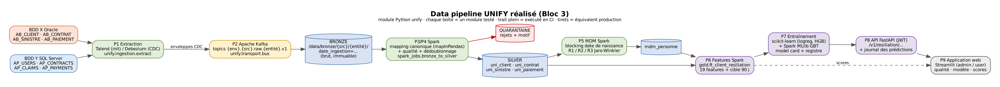

# UNIFY · Plateforme Data & IA unifiée AbAssurance × AssurePlus

[](__GITHUB_URL__/actions/workflows/ci.yml)
 


Projet du **Bloc 3 « Développer une solution digitale »** – Bachelor Concepteur Développeur en IA.
Auteur : **AGBIDIHO Mario** – suite des Blocs 1 (spécification, DFD) et 2 (Scrum, tests, risques).

| Description | Valeur |
|---|---|
| Dépôt Git (public) | __GITHUB_URL__ |
| Application déployée | __APP_URL__ |
| Compte **admin** | `admin` / `Admin#2026!` |
| Compte **user** | `user` / `User#2026!` |
| Branches permanentes | `main` (production) · `develop` (intégration) |
| Convention de nommage | [docs/CONVENTION_BRANCHES.md](docs/CONVENTION_BRANCHES.md) |
| Qualité de code | ruff · bandit · SonarCloud ([sonar-project.properties](sonar-project.properties)) |
| Tests / couverture | `pytest --cov` – 146 tests, couverture ≈ 98 % (seuil bloquant 80 %) |

## Ce que fait la solution

Unifier les bases **Oracle (AB_\*)** et **SQL Server (AP_\*)** dans un data lake Hadoop, puis
prédire la **résiliation à 90 jours** (cas d'usage MVP retenu au Bloc 1) :



| Étape (DFD Bloc 1) | Outil cible | Implémentation dans ce dépôt |
|---|---|---|
| P1 Capture & extraction | Talend + Debezium | `unify.ingestion.extract`, `talend/`, `config/debezium/` |
| P2 Transport | Apache Kafka (KRaft) + Schema Registry | `unify.transport.bus` (Kafka ou mémoire) |
| P3/P4 Standardisation + qualité | Spark | `unify.mapping`, `unify.quality`, `spark_jobs/bronze_to_silver.py` |
| P5 MDM (golden record) | Spark | `unify.mdm`, `spark_jobs/mdm_job.py` |
| P6 Features | Spark | `spark_jobs/features_job.py` → `gold.ft_client_resiliation` |
| P7 Entraînement | scikit-learn + Spark MLlib | `unify.ml.train`, `spark_jobs/train_job.py` |
| P8 Service de prédiction | FastAPI (JWT) | `unify.api` – OpenAPI sur `/docs` |
| P9 Restitution | Streamlit | `app/streamlit_app.py` |

Modèle de données final : [MCD](docs/img/mcd_unify.png) · [MLD / DDL](sql/03_silver_unifie_mld.sql) ·
règles de mapping : [config/mapping.yaml](config/mapping.yaml).

## Démarrage rapide

```bash
python -m venv .venv && source .venv/bin/activate
pip install -e ".[spark,api,app,dev]"        # Java 17+ requis pour Spark

unify run                                    # pipeline complet P0 -> P8 (~4 min)
pytest --cov                                 # tests + couverture
uvicorn unify.api.main:app --reload          # API  : http://localhost:8000/docs
streamlit run app/streamlit_app.py           # appli : http://localhost:8501
docker compose up -d                         # plateforme complète (Kafka, HDFS, Spark, MLflow…)
```

Les données sont **synthétiques** (générateur `unify.sources.generator`, échelle 1/2 000) :
elles respectent exactement les schémas de l'annexe et reproduisent leurs défauts (dates en
texte, statuts hétérogènes, clients communs sans clé partagée…). Aucune donnée réelle sur Git.

## Structure

```
config/            mapping.yaml (data mapping) · referentiels.yaml · connecteurs Debezium
src/unify/         package Python (common, ingestion, transport, mapping, quality, mdm,
                   lake, spark_jobs, ml, api, pipeline)
tests/             tests unitaires + test d'intégration Spark de bout en bout
app/               application Streamlit (login admin / user)
sql/               DDL sources (Oracle, SQL Server) et MLD de la base unifiée
talend/  airflow/  conception des jobs Talend · DAG d'orchestration
docs/              MCD, schémas, convention de branches, rapport de bug UNI-42
data/demo/         artefacts publiés : modèle, model card, scores, rapport du pipeline
```

## Licence
MIT – projet pédagogique.
